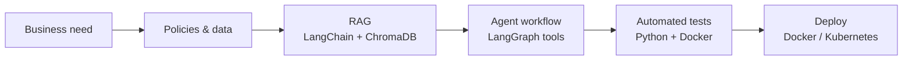

# Hi, I'm Nada 👋

**AI Engineer** building LLM applications and agents that turn messy business processes into reliable, grounded automation.

```python
class Nada:
    role       = "AI Engineer"
    focus      = ["Generative AI", "LLMs", "RAG", "Agentic AI", "NLP"]
    education  = "BSc Computer Science, Zagazig University (GPA 3.7/4.0, Honors)"
    languages  = {"Arabic": "native", "English": "professional"}
    exploring  = ["Agentic workflows", "Dify", "Apache Spark", "MLOps"]

    def how_i_work(self):
        return "Start from the real operational need, then build, test, and ship."
```

---

## How I build LLM applications



I care about answers that are **grounded in real data**, agents that are **tested against real scenarios**, and systems that actually **ship**.

---

## Projects

<details open>
<summary><b>Agentic AI Operations Assistant</b></summary>

<br>

An agent that analyzes customer orders, shipment status, and operational policies to automate customer service decisions.

- RAG architecture with **LangChain + ChromaDB** so responses stay grounded in business policies
- Tool-based workflows with **LangGraph**: order lookup, shipment analysis, delay detection, compensation recommendations
- Automated test cases (Python + Docker) covering agent reasoning, policy compliance, and compensation decisions across multiple scenarios

`LangChain` `LangGraph` `ChromaDB` `Python` `Docker`

</details>

<details>
<summary><b>End-to-End AI Resume Screening System</b></summary>

<br>

A production-style system that classifies and matches resumes with job descriptions.

- NLP preprocessing and text mining pipeline with **NLTK**
- **80%** model accuracy
- Containerized and deployed with **Flask, Docker, and Kubernetes**, with CI/CD automating build and deployment

`NLTK` `Flask` `Docker` `Kubernetes` `CI/CD`

</details>

<details>
<summary><b>EEG-Based Mental Illness Classification (Graduation Project)</b></summary>

<br>

A machine learning diagnostic system using EEG signals and symptom data.

- Signal artifact removal, feature extraction, and model evaluation pipelines
- **98%** classification accuracy

`Python` `Machine Learning` `Signal Processing`

</details>

<details>
<summary><b>ML Workflow on AWS SageMaker (Scones Unlimited)</b></summary>

<br>

An end-to-end cloud ML workflow: preprocessing, training, hyperparameter tuning, and endpoint deployment.

`AWS SageMaker` `MLOps`

</details>

---

## Toolbox

| | |
| --- | --- |
| **GenAI** | `LLMs` `RAG` `Agentic AI` `Prompt Engineering` `LangChain` `LangGraph` `Dify` `ChromaDB` |
| **ML** | `Python` `PyTorch` `TensorFlow` `Scikit-learn` `NLTK` `Pandas` `NumPy` `SciPy` |
| **Ship** | `Docker` `Kubernetes` `AWS (SageMaker, RDS)` `Flask` `Git` `Apache Spark` |

---

## Journey

- **2026** · Part-Time AI Instructor at iSchool, Digital Egypt Cubs Initiative (DECI, MCIT): taught AI and programming through project-based sessions
- **2025–2026** · Data Science & Cloud Computing Intern at Digital Egypt Builders Initiative (DEBI): Apache Spark, cloud, and MLOps
- **2025** · Sprints Generative AI and Innovation Certification
- **2024** · AWS Machine Learning Engineer Training · Graduated with honors
- **2023** · AWS AI Programming with Python

Also: Team Leader at InnoEgypt Entrepreneurship Program, and volunteer with Life Makers (صناع الحياة).

---

## Let's talk

[LinkedIn](https://linkedin.com/in/nada-ayman-1692a3224) · [Email](mailto:na6513210@gmail.com) · [Portfolio](https://nada1267.github.io/protfolio)
